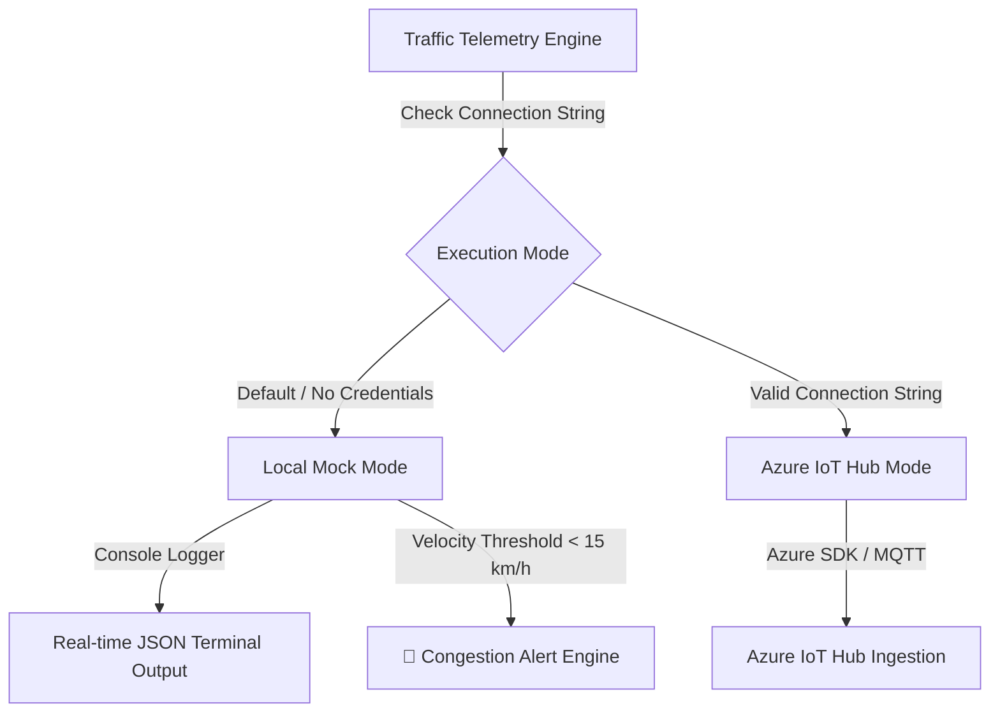

# Azure IoT Traffic Simulator

A dual-mode Python IoT device simulator designed for real-time traffic velocity monitoring and congestion detection. The system operates seamlessly in both a **Standalone Local Mock Mode** for offline testing and an **Azure IoT Hub Production Mode** for real-time Cloud telemetry streaming.

---

## 🏗️ System Architecture



---

## ✨ Key Features

* **Dual-Mode Execution Architecture:** Auto-fallback to Local Mock Mode when Azure credentials are missing, allowing zero-dependency testing and offline demonstration.
* **Real-time Velocity Modeling:** Simulates dynamic vehicle acceleration and deceleration using random uniform delta steps.
* **Congestion Alert Threshold:** Detects traffic bottlenecks and triggers real-time alerts when vehicle velocity drops below $15\text{ km/h}$.
* **Clean JSON Payload Serialization:** Exports telemetry structured with device identification, speed metrics, and timestamps.
* **Graceful Interrupt Handling:** Captures `KeyboardInterrupt` (`Ctrl+C`) to clean up client sockets and execution loops safely.

---

## ⚙️ Prerequisites & Setup

### Requirements
* **OS:** Linux / Pop!_OS / macOS / Windows
* **Python:** 3.8+
* **Dependencies:** `azure-iot-device` *(Optional: Required only when connecting to live Azure IoT Hub)*

### Installation
```bash
# Clone the repository
git clone [https://github.com/Dmitrizakanilov279/azure-iot-traffic-simulator.git](https://github.com/Dmitrizakanilov279/azure-iot-traffic-simulator.git)
cd azure-iot-traffic-simulator

# Set up virtual environment
python3 -m venv venv
source venv/bin/activate

# Install Azure IoT SDK (Optional for Azure mode)
pip install azure-iot-device
```

---

## 💻 Configuration & Execution

### 1. Running in Local Mock Mode (Default)
Keep `CONNECTION_STRING = "YOUR_DEVICE_CONNECTION_STRING_HERE"` in the script and execute directly:

```bash
python simulator.py
```

### 2. Running in Azure IoT Hub Mode
Update the connection string variable in `simulator.py` with your Azure IoT device credentials:

```python
CONNECTION_STRING = "HostName=YOUR_HUB.azure-devices.net;DeviceId=SmartTrafficSimulated;SharedAccessKey=YOUR_KEY"
```

---

## 📊 Telemetry Output Schema

### Local Console Output Example
```json
{
  "deviceId": "SmartTrafficSimulated",
  "current_velocity_kmh": 12.45,
  "timestamp": "2026-10-31 09:12:00"
}
```

When velocity drops below $15.0\text{ km/h}$, the local alert system triggers:
```text
🚨 [ALERT] ตรวจพบการจราจรติดขัด! ความเร็วต่ำกว่าเกณฑ์
```

---

## 📄 License

Distributed under the MIT License. See `LICENSE` for details.
