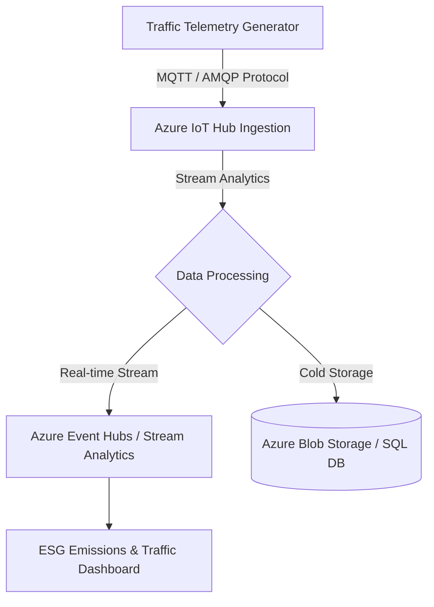

# Azure IoT Traffic & Environmental Simulator

A Python-based Azure IoT Hub device simulator designed for real-time traffic monitoring, congestion pattern modeling, and PM2.5 emissions analytics aligned with ESG (Environmental, Social, and Governance) engineering principles.

---

## 🏗️ System Architecture



---

## ⚙️ Setup & Configuration

### Prerequisites
* Python 3.10+
* Azure IoT Hub Instance & Device Connection String

### Installation
```bash
git clone [https://github.com/Dmitrizakanilov279/azure-iot-traffic-simulator.git](https://github.com/Dmitrizakanilov279/azure-iot-traffic-simulator.git)
cd azure-iot-traffic-simulator

python3 -m venv venv
source venv/bin/activate
pip install -r requirements.txt
```

### Environment Configuration
Create a `.env` file in the root directory:
```env
IOTHUB_DEVICE_CONNECTION_STRING="HostName=YOUR_HUB.azure-devices.net;DeviceId=TrafficSensor01;SharedAccessKey=YOUR_KEY"
SIMULATION_INTERVAL_SECONDS=5
```

---

## 💻 Execution & Payload Schema

### Run Simulator
```bash
python simulator.py
```

### Generated Telemetry Payload
```json
{
  "device_id": "TrafficSensor01",
  "timestamp": "2026-10-31T08:15:30Z",
  "location": {
    "latitude": 13.7563,
    "longitude": 100.5018
  },
  "metrics": {
    "vehicle_count_per_min": 142,
    "average_speed_kmh": 34.2,
    "pm2_5_ug_m3": 48.6,
    "co2_estimate_kg": 12.4
  }
}
```
